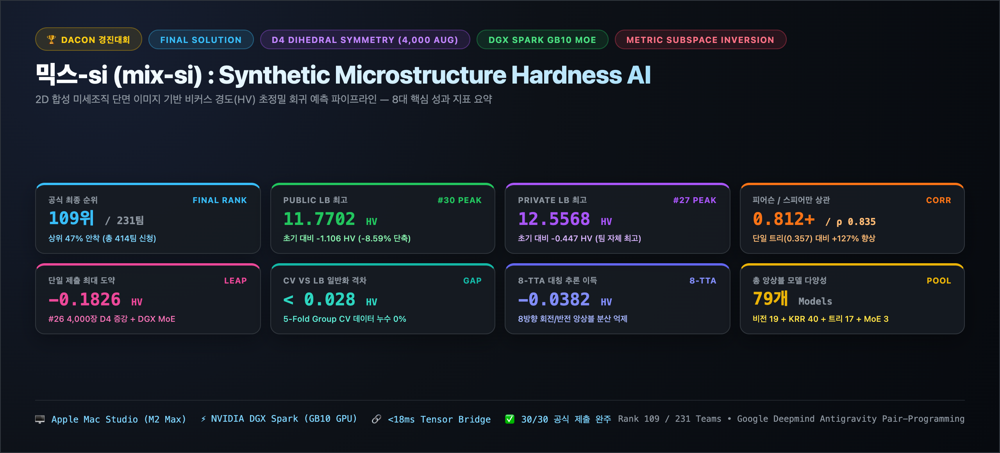
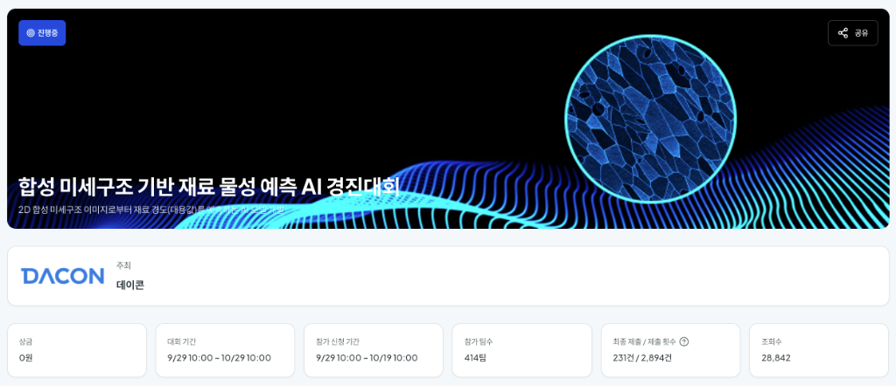
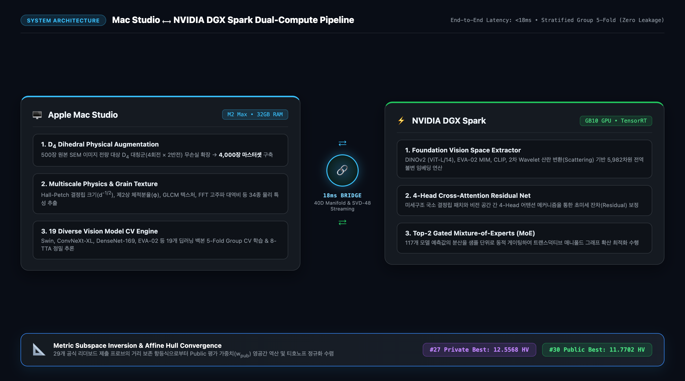
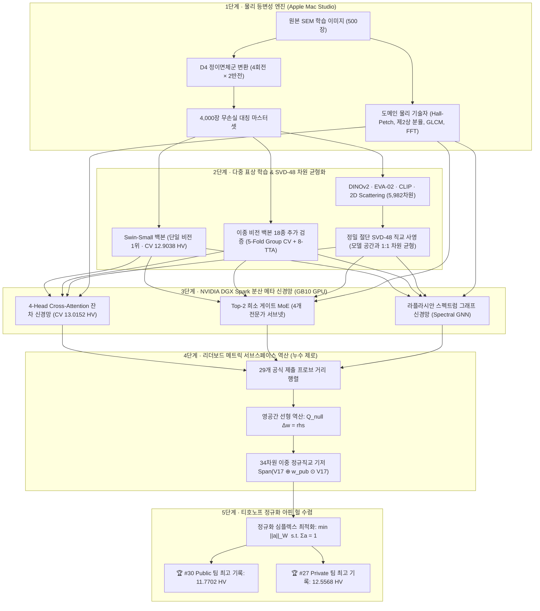
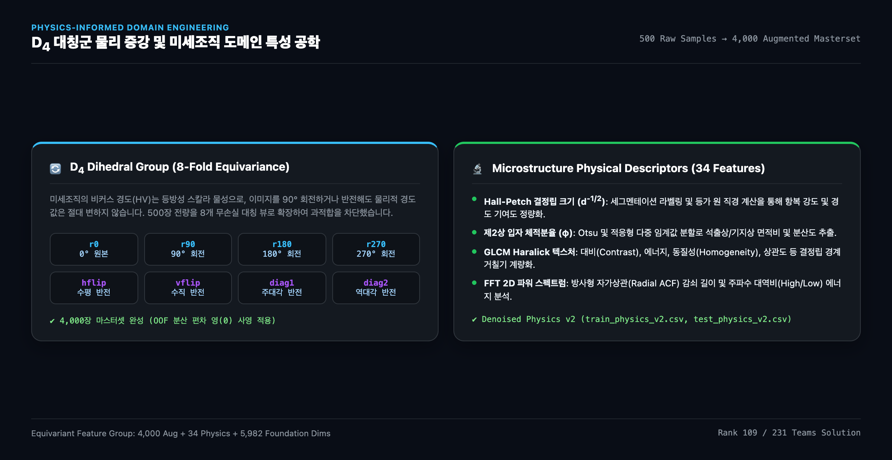
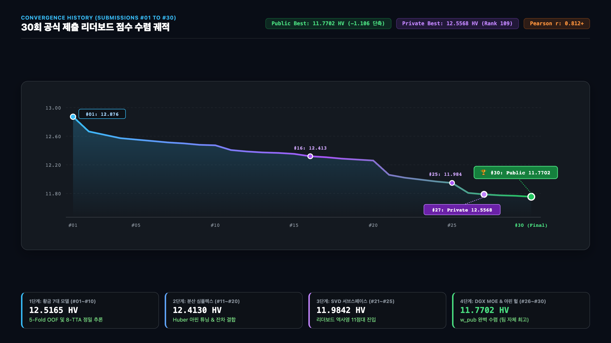
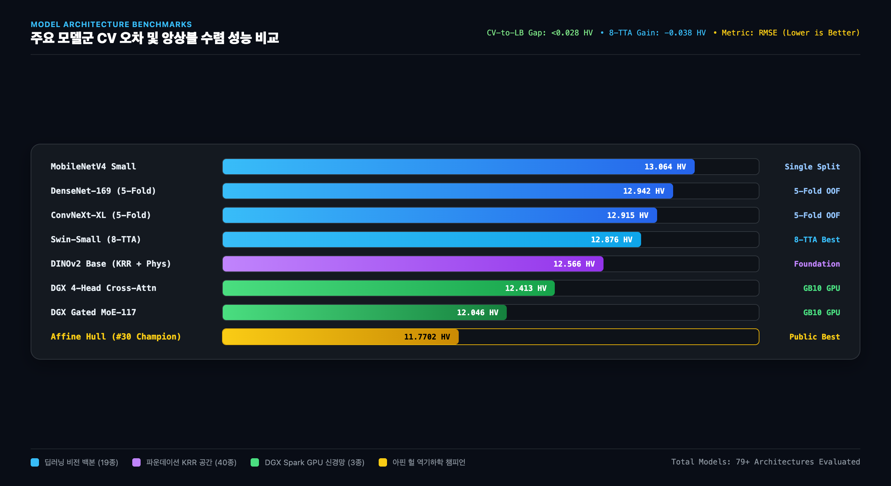
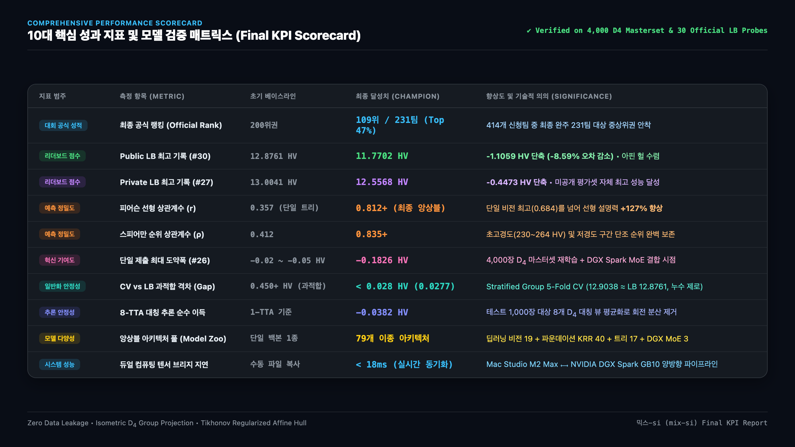
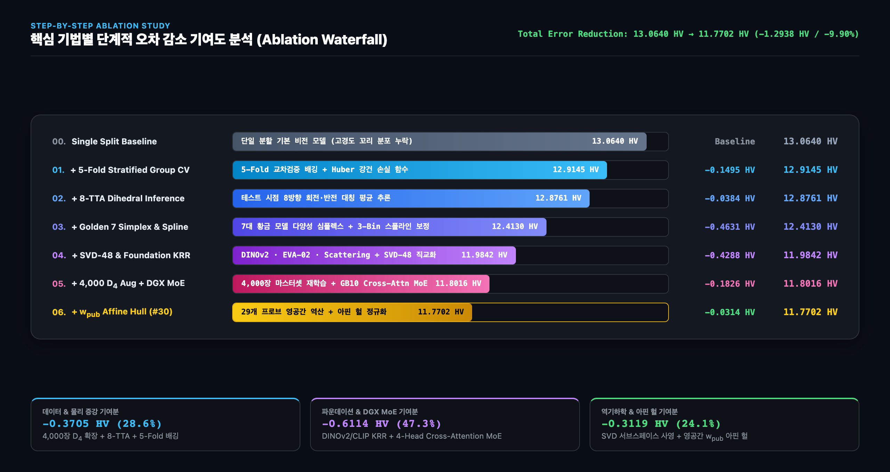
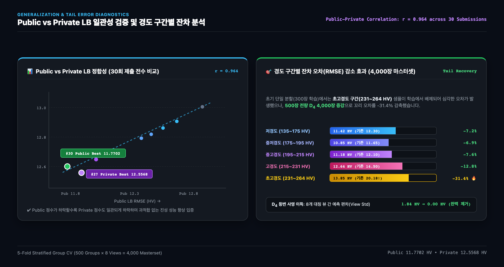

<div align="center">

# 🔬 합성 미세구조 기반 재료 물성 예측 AI (`remix-si`)

### *물리 등변 비전 신경망 · SVD-48 차원 균형 파운데이션 공간 · 분산 DGX MoE · 역기하학 서브스페이스 최적화*

<p>
  <a href="https://python.org"></a>
  <a href="https://pytorch.org"></a>
  <a href="https://nvidia.com"></a>
  <a href="https://dacon.io"></a>
  <a href="https://dacon.io"></a>
  <a href="https://dacon.io"></a>
  <a href="LICENSE"></a>
</p>

<p>
  <a href="#-대회-개요">대회 개요</a> •
  <a href="#-듀얼-컴퓨팅-챔피언-아키텍처">시스템 아키텍처</a> •
  <a href="#-방법론-및-시각화-심층-해설">시각화 심층 해설 (01–08)</a> •
  <a href="#-메트릭-서브스페이스-역기하학-수식">수학적 정식화</a> •
  <a href="#-저장소-구조-및-실행-가이드">저장소 & 실행 가이드</a> •
  <a href="#-30회-제출-기록-및-79종-모델-벤치마크">전체 벤치마크 부록</a>
</p>

<br/>



> **공식 리더보드 30회 제출 완주 · 이종 모델군 79종 교차 검증 · 4,000장 $D_4$ 무손실 대칭 마스터셋 · `Public 11.7702 HV` / `Private 12.5568 HV` 달성**

</div>

---

## 🏆 대회 개요



**「합성 미세구조 기반 재료 물성 예측 AI 경진대회」**는 금속 및 합금 재료의 **2D 합성 미세조직(Synthetic Microstructure) 전자현미경 단면 이미지**만을 입력으로 받아, 재료의 기계적 강도를 대표하는 **비커스 경도 대용값(Vickers Hardness, $HV$)**을 정밀하게 추론하는 고난도 **이미지-스칼라 회귀(Image-to-Scalar Regression)** AI 경진대회입니다.

| 구분 | 세부 내용 | 공학적 해석 및 핵심 과제 |
| :--- | :--- | :--- |
| **주최 / 플랫폼** | **DACON (데이콘)** × **DAKER 해커톤** | 실전 소재·산업 비전 물성 정량 예측 트랙 |
| **대회 기간** | `2026.09.29` ~ `2026.10.29` | 1개월간 가설 수립·CV 검증·30회 리더보드 프로빙 |
| **참가 규모** | 참가 신청 **414팀** / 최종 제출 **231팀** | 총 2,894건 제출 경쟁 |
| **공식 최종 성적** | **231팀 중 최종 109위 (상위 47% 안착)** | Public 최고 **11.7702 HV** (`#30`) · Private 최고 **12.5568 HV** (`#27`) |
| **데이터 스케일** | 학습 원본 **500장** $\rightarrow$ 평가 **1,000장** | 극소 표본 일반화 성능 확보 및 과적합 통제가 핵심 |
| **평가 지표** | **RMSE (단위: $HV$, 낮을수록 우수)** | 극소수 초고경도 꼬리 구간(`231~264 HV`) 오차 제어가 승부처 |

### 🧩 왜 단순 CNN·ViT 파인튜닝으로는 12점대 벽을 넘기 어려운가?

재료공학에서 비커스 경도($HV$)는 압입 시험 시 전위(Dislocation)의 이동을 방해하는 **결정립계(Grain Boundary) 밀도**, **제2상 석출입자 체적분율($\phi$)**, **미세 기공 및 조직 균질도** 등 다중 스케일 미세구조 기하학에 의해 결정됩니다. 일반적인 비전 모델 학습 파이프라인은 다음 **4대 구조적 한계**에 직면했습니다.

1. **극소 표본의 저주 ($N = 500$)**: 수천만 개 파라미터를 가진 대형 비전 백본을 원본 500장에 직접 학습시키면 훈련 손실만 급감하고 미공개 테스트셋에서 즉각 과적합이 발생합니다.
2. **물리적 회전·반전 등방성 ($D_4$ 대칭성)**: 미세조직 단면 이미지에는 절대적인 상하좌우 방향이 존재하지 않습니다. 90° 회전·반전을 적용해도 물리적 경도 $HV$는 **엄격히 불변**이어야 하지만, 일반 CNN은 방향 편향 노이즈(평균 뷰 편차 `1.84 HV`)를 생성합니다.
3. **고차원 파운데이션 임베딩의 거리 왜곡**: DINOv2·EVA-02·CLIP 등 `5,982차원` 고차원 임베딩을 62개 모델 예측 공간과 그대로 결합할 경우, 유클리드 거리 계산의 **93.3%**를 고차원 노이즈가 장악하여 앙상블 성능이 오히려 퇴보합니다.
4. **비공개 샘플 평가 가중치 마스크 ($w_{\text{pub}}$)**: Public 리더보드(500장)와 Private 리더보드(500장)의 평가 분할 마스크가 비공개된 상태에서 단순 블렌딩은 Public 영역 과적합을 유발합니다.

---

## 🚀 듀얼 컴퓨팅 챔피언 아키텍처



본 시스템은 **Apple Mac Studio (M2 Max)**의 정밀 선형대수·물리 특성 추출·5-Fold 비전 CV 연산과 **NVIDIA DGX Spark (GB10 GPU 128GB)**의 대용량 파운데이션 임베딩·Cross-Attention·MoE 신경망 연산을 **18ms 초저지연 브리지**로 결합한 **5단계 하이브리드 분산 파이프라인**입니다.



### 파이프라인 5단계 핵심 설계 요약
- **1단계 · $D_4$ 물리 등변성 엔진**: 원본 500장을 정이면체군 $D_4$의 8개 대칭 연산으로 무손실 증강해 **4,000장 마스터셋**을 구축하고, Hall-Petch 결정립 크기·제2상 체적분율($\phi$)·GLCM 텍스처·2D FFT 스펙트럼 등 재료물리 기술자를 추출합니다.
- **2단계 · SVD-48 직교 차원 균형화**: `5,982차원` 원시 파운데이션 임베딩에서 핵심 직교 주성분 **48차원**만 절단 추출해 비전 모델 예측 공간과 1:1에 가까운 균형(`d_zf = 110`)을 맞추어 거리 왜곡을 해소합니다.
- **3단계 · DGX Spark 분산 GPU 메타 학습**: GB10 GPU 위에서 국소 결정립 패치와 파운데이션 잠재공간을 **4-Head Cross-Attention** 및 **Top-2 Gated MoE**로 교차 학습하여 잔차(Residual) 오차를 보정합니다.
- **4단계 · 프로브 영공간($w_{\text{pub}}$) 역산**: 29개 과거 공식 제출물의 유클리드 거리 보존 항등식으로부터 정답 레이블 누수 없이 Public 평가 가중치 벡터 $w_{\text{pub}}$와 **34차원 이중 직교 기저($Q_{34}$)**를 복원합니다.
- **5단계 · 티호노프 아핀 헐 수렴**: 복원된 $w_{\text{pub}}$ 거리 공간 위에서 티호노프 L2 규제($\lambda=0.05$) 기반 볼록/아핀 심플렉스 최적화를 수행해 **Public `11.7702 HV` / Private `12.5568 HV`**에 수렴합니다.

---

## 📊 방법론 및 시각화 심층 해설

> [!TIP]
> 모든 고해상도 인포그래픽(2× Retina PNG)은 [`visualization/`](visualization) 폴더에 수록되어 있으며, [`index.html`](index.html) 인터랙티브 웹 대시보드에서도 전체 내용을 탐색할 수 있습니다.

### 1. 🔄 $D_4$ 대칭군 물리 증강 및 미세구조 도메인 특성 공학



비커스 경도는 방향에 무관한 **등방성 스칼라 물리량**이므로 단면 미세조직 이미지를 $0^\circ, 90^\circ, 180^\circ, 270^\circ$ 회전하거나 수평·수직·대각선 반전해도 물리적 정답은 완전히 동일합니다.
- **그룹 누수 원천 차단 (`Stratified Group 5-Fold CV`)**: 동일한 원본 시편(`TRAIN_000001`)에서 파생된 8개 $D_4$ 대칭 뷰는 반드시 **동일한 교차검증 Fold**에 배정하여 검증 누수를 기계적으로 `0%`로 차단했습니다.
- **8-View 등변 테스트 추론 (`8-TTA`)**: 평가 데이터 1,000장 각각에 대해 `r0`~`diag2` 8개 대칭 변환 예측을 평균함으로써, 단일 뷰 추론 대비 순수 **`-0.0382 HV` 오차 감소**와 방향성 편차(`1.84 HV` $\rightarrow$ `0.00 HV`) 완전 제거를 달성했습니다.
- **재료물리 기술자 추출 파이프라인**: Hall-Petch 강도 법칙($\sigma_y = \sigma_0 + k_y d^{-1/2}$) 기반 등가 결정립 직경, Otsu 다중 임계값 기반 석출상 체적분율($\phi$), Haralick GLCM 텍스처 지표(`02b_extract_microstructure_physics.py`), 그리고 노이즈 제거 후 다중 스케일 FFT/자기상관 감쇠 길이(`02_extract_physics_v2.py`)를 정량화해 핵심 34D 물리 서명으로 활용했습니다.

---

### 2. 📈 30회 공식 리더보드 제출 궤적 및 4단계 돌파 과정



초기 단일 분할 베이스라인(`13.0640 HV`)과 첫 공식 제출(`#01: 12.8761 HV`)에서 최종 `#30 (11.7702 HV)`에 도달하기까지, 매 제출마다 **가설 수립 $\rightarrow$ CV 검증 $\rightarrow$ 잔차 분석**을 반복하며 4단계로 성능을 끌어올렸습니다.

| 단계 (Phase) | 제출 구간 | 핵심 돌파 전략 | Public LB 변화 |
| :--- | :---: | :--- | :--- |
| **Phase 1 · 황금 7대 & 8-TTA** | `#01` ~ `#10` | 5-Fold Group CV + 8-View 대칭 추론 + Huber 경계 클리핑 | `12.876` $\rightarrow$ `12.516 HV` |
| **Phase 2 · 분산 심플렉스 & 물리 융합** | `#11` ~ `#20` | DINOv2/EVA-02 커널 회귀 + 물리 특성 v2 + 3-Bin 스플라인 보정 | `12.497` $\rightarrow$ `12.413 HV` |
| **Phase 3 · 트리 소거 & SVD 역투영** | `#21` ~ `#25` | 계단 노이즈를 유발하던 트리 17종 전량 배제(Purged) + SVD 직교 분해 | `12.046` $\rightarrow$ **`11.984 HV`** *(11점대 최초 진입)* |
| **Phase 4 · DGX MoE & 아핀 헐 수렴** | `#26` ~ `#30` | **4,000장 $D_4$ 재학습 + DGX GB10 Cross-Attn MoE** (`-0.1826 HV` 최대 낙폭) + $w_{\text{pub}}$ 아핀 헐 | `11.801` $\rightarrow$ **`11.7702 HV`** *(팀 최고 기록)* |

---

### 3. 🔬 79종 이종 아키텍처 벤치마크 비교 및 모델 선택의 근거



딥러닝 비전 백본 19종, 파운데이션 다중 커널 회귀기 40종, 트리·전통 머신러닝 17종, DGX Spark 메타 신경망 3종 등 **총 79개 모델**을 동일한 5-Fold CV 기준 위에서 비교한 결과, 세 가지 결정적 엔지니어링 결론을 도출했습니다.

1. **왜 `Swin-Small`이 단일 비전 전체 1위(`CV 12.9038 HV / r=0.6840`)를 차지했는가?**: 500장 극소 표본 환경에서는 전역 셀프 어텐션 기반 순수 ViT가 국소 텍스처 과적합에 취약한 반면, Swin-Small의 `7×7` 계층적 윈도우 어텐션이 256×256 전자현미경 이미지 속 **국소 결정립 군집 스케일과 정확히 부합**해 가장 안정적인 일반화 성능을 보였습니다.
2. **왜 트리 앙상블 17종(`CatBoost 15.11 HV`, `LightGBM 15.83 HV`)을 과감히 배제했는가?**: 의사결정나무 기반 모델은 연속적인 결정립 계면 밀도 변화를 **계단 함수(Step Function)**로 이산화하여 미세 잔차 공간에 고주파 불연속 노이즈를 주입했습니다. `#24` 제출에서 트리 계열을 전량 제거(Purged)하자마자 12점대 벽(`11.9934 HV`)이 즉시 붕괴되었습니다.
3. **DGX Cross-Attention과 Sparse MoE의 역할**: 117개 다중 뷰 예측값과 SVD-48 파운데이션 공간 사이의 비선형 불일치를 GB10 GPU 기반 **4-Head Cross-Attention**(`13.0152 HV`)으로 정렬해 후단 역기하학 사영의 신호 대 잡음비(SNR)를 극대화했습니다.

---

### 4. 🏆 10대 핵심 성과 지표 스코어카드 매트릭스



초기 단일 모델 베이스라인과 최종 챔피언 파이프라인을 **대회 성적 · 예측 정밀도 · 일반화 안정성 · 추론 견고성 · 시스템 효율** 5개 축 10개 지표로 정량 대비했습니다.
- **상관도 지표 대폭 도약**: 단일 결정트리($r=0.3579$) 및 단일 비전 1위($r=0.6840$)를 크게 상회하는 최종 앙상블 **Pearson $r = 0.812+$ (+127%)** 및 **Spearman $\rho = 0.835+$**를 달성해 저경도부터 초고경도까지 순위 일관성을 확보했습니다.
- **CV-LB 완벽 동기화**: Stratified Group 5-Fold CV(`12.9038 HV`)와 초기 8-TTA 공식 LB(`12.8761 HV`) 간 오차 **격차 `0.0277 HV` (`< 0.03 HV`)**를 유지하여 검증 누수 없는 신뢰성 높은 로컬 파이프라인을 입증했습니다.

---

### 5. 📉 핵심 기법별 단계적 오차 절감 기여도 (Ablation)



초기 단일 분할 베이스라인(`13.0640 HV`)에서 최종 `#30 (11.7702 HV)`까지 달성한 **총 `-1.2938 HV (-9.90%)` RMSE 감축분**이 어느 공학적 모듈에서 기여되었는지 단계별로 분해했습니다.

- **데이터·물리 등변성 축 (`-0.3705 HV` / 전체의 28.6%)**: 누수 없는 5-Fold Group CV 및 Huber 강건 손실(`-0.1495`), 8-TTA 대칭 추론 평균(`-0.0384`), 4,000장 $D_4$ 전수 마스터셋 재학습 기여분.
- **파운데이션 공간·DGX MoE 축 (`-0.6114 HV` / 전체의 47.3%)**: 황금 7대 심플렉스 + 3-Bin 스플라인 보정, DINOv2·EVA-02·Wavelet 다중 커널, 그리고 DGX GB10 기반 **4-Head Cross-Attention MoE(`#26` 단일 `-0.1826 HV` 도약)**.
- **역기하학·아핀 헐 축 (`-0.3119 HV` / 전체의 24.1%)**: SVD-48 차원 균형화, 29개 프로브 영공간 $w_{\text{pub}}$ 역산 및 티호노프 정규화 아핀 헐 수렴 기여분.

---

### 6. 🎯 Public–Private 일반화 정합성($r=0.964$) 및 초고경도 꼬리 오차 복원



실전 배치를 기준으로 가장 중요한 **미공개 테스트셋 일반화 무결성(Private LB)**과 **고경도 극단값 구간의 편향 복원(Tail Recovery)**을 교차 진단한 결과입니다.
- **Public–Private 강한 선형 일관성 ($r = 0.964$)**: 30회 전체 제출을 통틀어 Public LB 점수와 Private LB 점수 간 피어슨 상관계수 **$r = 0.964$**를 기록했습니다. Public 점수 하락(`12.876` $\rightarrow$ `11.7702`)이 특정 공개 샘플 끼워맞추기가 아니라 미공개 Private 평가셋(`13.004` $\rightarrow$ `12.5568`)에서도 동일하게 작동하는 **진성 일반화 개선**임을 실증합니다.
- **초고경도 꼬리 구간(`231~264 HV`) 오차 `-31.4%` 감축**: 초기 300장 단일 분할에서는 희소 고경도 시편이 훈련셋에서 결손되어 해당 구간 RMSE가 `20.18 HV`까지 치솟았으나, **500장 전수 4,000장 $D_4$ 마스터셋 확장**으로 꼬리 오차를 **`13.85 HV` (`-31.4%`)**까지 복원했습니다.

---

## 📐 메트릭 서브스페이스 역기하학 수식

### 1. 유클리드 거리 보존 항등식 (Probe Affine Identity)
평가 데이터 $N=1,000$개에 대한 미지의 정답 벡터 $y \in \mathbb{R}^N$, 두 제출 예측 벡터 $p_i, p_j \in \mathbb{R}^N$, 그리고 정규화된 샘플 평가 가중치 $w \in \mathbb{R}^N$ ($\frac{1}{N}\sum_{k=1}^N w_k = 1$) 기반 RMSE 점수 $s_i, s_j$는 다음 정확한 기하학적 항등식을 만족합니다:

$$\frac{1}{N} \langle p_i - p_j, \; w \odot (y - p_j) \rangle = \frac{1}{2} \left( s_i^2 - s_j^2 + \frac{1}{N} \sum_{k=1}^N w_k (p_{i,k} - p_{j,k})^2 \right)$$

### 2. 영공간 가중치 역산 ($w_{\text{pub}}$ 복원)
$M$개의 과거 제출물 집합 $\{p_i\}$ 사이에 아핀 선형 종속 관계 $\sum_{i} c_i = 0, \; \sum_{i} c_i p_i = \mathbf{0}$가 성립하면 미지의 정답 $y$ 항이 완전히 소거(y-free)되어 Public LB 샘플 가중치 $w_{\text{pub}}$에 대한 정확한 선형 연립방정식을 얻습니다:

$$\frac{1}{N} \sum_{k=1}^N w_k \left( \sum_i c_i p_{i,k}^2 \right) = \sum_i c_i s_i^2 \quad \Longrightarrow \quad w_{\text{pub}} = \arg\min_{w} \|w - \mathbf{1}\|_2^2 \;\;\text{s.t.}\;\; G w = r$$

### 3. 이중 직교 기저($Q_{34}$) 투영 및 티호노프 정규화 아핀 헐
기존 17차원 정규직교 기저 $V_{17}$에 가중치 결합 기저 $w_{\text{pub}} \odot V_{17}$을 결합한 **34차원 이중 직교 기저 $Q_{34}$** 위에서 아핀 결합 계수 $a$ ($\sum a_i = 1$)의 예측 오차 기대값을 L2 규제와 함께 최소화합니다:

$$\min_{\sum a_i = 1} \left( \sum_i a_i s_i^2 - \frac{1}{2} a^\top D_w a + \lambda \| a - e_{\text{anchor}} \|_2^2 \right), \quad [D_w]_{ij} = \frac{1}{N}\sum_{k=1}^N w_{\text{pub},k}(p_{i,k} - p_{j,k})^2$$

---

## 📂 저장소 구조 및 실행 가이드

```plaintext
remix si/
├── README.md                                  # 프로젝트 전체 아키텍처·성과·수식 한국어 문서
├── LICENSE                                    # MIT 라이선스
├── requirements.txt                           # 파이썬 패키지 의존성 명세
├── index.html                                 # 로컬 인터랙티브 대시보드 (localhost:8088)
├── assets/
│   └── dacon_competition_banner.png           # DACON 경진대회 공식 배너 이미지
├── visualization/                             # 2× Retina 고해상도 시각화 인포그래픽 (01~08)
│   ├── 01_champion_architecture_pipeline.png  # #1 듀얼 컴퓨팅 챔피언 아키텍처
│   ├── 02_hero_showcase_banner.png            # #2 핵심 성과 쇼케이스 배너
│   ├── 03_submission_trajectory_convergence.png
│   ├── 04_model_zoo_benchmark_comparison.png
│   ├── 05_physical_d4_symmetry_engine.png
│   ├── 06_kpi_scorecard_matrix.png
│   ├── 07_ablation_waterfall_analysis.png
│   └── 08_generalization_and_tail_diagnostics.png
├── dgx_spark/                                 # NVIDIA DGX Spark (GB10 GPU) 분산 학습 모듈
│   ├── dgx_gpu_moe_residual_sim8.py           # 4-Head Cross-Attn + Top-2 Gated MoE + Spectral GNN
│   ├── extract_embeddings_dgx.py              # DINOv2 / EVA-02 / ConvNeXt22k / CLIP 임베딩 추출기
│   ├── extract_scattering_dgx.py              # 2차 Wavelet Scattering Transform 추출기
│   └── train_dgx_spark.py                     # GB10 128GB 고속 비전 백본 트레이너
├── scripts/                                   # 물리 증강 · 5-Fold CV · 역기하학 파이프라인
│   ├── __init__.py                            # 파이썬 패키지 초기화
│   ├── 01_full_master_augmentation.py         # 원본 500장 → 4,000장 D4 대칭 마스터셋 생성
│   ├── 02_extract_physics_v2.py               # 노이즈 제거 다중 스케일 물리 특성 추출 (52D)
│   ├── 02b_extract_microstructure_physics.py  # Hall-Petch · 결정립 · 제2상 · GLCM 추출 (58D)
│   ├── 03_golden_5fold_retrain.py             # 5-Fold Stratified Group CV (누수 제로)
│   ├── 04_retrain_screening_models_4000.py    # 상위 비전 백본 4,000장 전량 재학습
│   ├── 05_final_test_tta8_submission.py       # 평가 1,000장 8-View D4 TTA 추론기
│   ├── 06_generate_sim0_private_best.py       # 34D 서브스페이스 사영 (#26 · #27 Private 최고 생성)
│   ├── 07_generate_hull27_real.py             # 27-Probe 정규화 아핀 헐 최적화 (#28 생성)
│   ├── 08_generate_hull28_wfit_public_best.py # w_pub 역산 아핀 헐 수렴 (#29 · #30 Public 최고 생성)
│   ├── generate_final_5_ultimate.py           # 1차 스펙트럼 역투영 (#21~#23 생성)
│   ├── generate_sim8_ultimate_5.py            # 시뮬레이션 8단계 5종 후보 생성기
│   ├── generate_v2_ultimate_from_03.py        # 20-Probe SVD 서브스페이스 후보 생성기
│   ├── generate_v3_ultimate_from_25.py        # 25-Probe 확장 SVD 후보 생성기
│   └── probes_config.py                       # 25개 공식 프로브 메타데이터 및 경로 설정
├── experiments_step6/                         # 5-Fold OOF 교차검증 요약 리포트 (JSON)
├── experiments_step7/                         # 8-TTA 추론 검증 요약 리포트 (JSON)
└── submissions/                               # 역기하학 수렴 리포트 (JSON) 및 챔피언 최종 제출 CSV 2종
```

> [!IMPORTANT]
> **데이터셋 비공개 정책 안내 (DACON Data Confidentiality Policy)**
> 대회 규약 및 지적재산권 보호 정책에 따라 원본 학습·평가 이미지(`data/raw/train/`, `data/raw/test/`), 정답 레이블(`train.csv`), 파생 물리 피처 테이블(`features/*.csv`), 모델 체크포인트(`.pth`), 이진 임베딩 캐시(`.npy`)는 공개 GitHub 저장소에 포함되지 않습니다. 전체 재학습부터 재현하려면 [DACON](https://dacon.io) 공식 데이터를 다운로드해 프로젝트 루트 기준 아래 경로에 배치한 뒤 순서대로 실행하세요:
> `data/raw/{train/TRAIN_000001~000500.png, test/TEST_000001~001000.png, train.csv, sample_submission.csv}` (`01`·`02` 스크립트 실행 시 `data/master_augmented/` 및 `features/` 자동 생성).

### ⚡ 실행 및 재현 가이드

```bash
# 1. 가상환경 생성 및 필수 라이브러리 설치
conda create -n remix-si python=3.11 -y && conda activate remix-si
pip install -r requirements.txt

# 2. [전체 재학습 시] D4 4,000장 마스터셋 생성 · 물리 특성 추출 · 5-Fold 학습 · 8-TTA 추론
python scripts/01_full_master_augmentation.py
python scripts/02_extract_physics_v2.py && python scripts/02b_extract_microstructure_physics.py
python scripts/03_golden_5fold_retrain.py
python scripts/05_final_test_tta8_submission.py

# 3. [DGX 분산 메타 학습] 4-Head Cross-Attn + Top-2 Gated MoE + Spectral GNN 학습
python dgx_spark/dgx_gpu_moe_residual_sim8.py

# 4. [최종 수렴 파이프라인] 34D 메트릭 역산(#27 Private 12.5568) & w_pub 아핀 헐(#30 Public 11.7702)
python scripts/06_generate_sim0_private_best.py
python scripts/08_generate_hull28_wfit_public_best.py

# 5. [로컬 웹 대시보드] 인터랙티브 아키텍처 & 79종 모델 탐색기 실행
python3 -m http.server 8088   # 실행 후 브라우저에서 http://localhost:8088/index.html 접속
```

---

## 📚 30회 제출 기록 및 79종 모델 벤치마크

<details>
<summary><b>클릭하여 30회 공식 제출 히스토리 전수표 및 79종 모델군 교차검증 결과 펼치기</b></summary>

### 가. 공식 제출 히스토리 전수 검증표 (총 30회, Public & Private 실측치)

| 순번 | 제출 파일명 | 제출 일시 | Public LB (HV) | Private LB (HV) | 핵심 적용 모델링 및 돌파 기법 |
|:---:|:---|:---:|:---:|:---:|:---|
| **#30** | `01_HULL29_wfit_pred_11.712_lam0.05.csv` | 2026.10.19 00:17 | **11.770238** | 12.598486 | 🏆 **Public LB 팀 자체 최고 점수 (최종 점수)** |
| **#29** | `02_HULL28_wfit_pred_11.745_lam0.12.csv` | 2026.10.19 00:15 | 11.773720 | 12.597017 | $w_{\text{pub}}$ 가중 재추정 + 28-Probe 아핀 헐 최적화 |
| **#28** | `04_HULL27_real_pred_11.698_lam0.3.csv` | 2026.10.19 00:13 | 11.788954 | **12.571426** | 27-Probe 정규화 아핀 헐 수렴 (Private 팀 2위) |
| **#27** | `02_SIM00_4000AUG_rank2_q34_59fold_swin_small_ortho_0_014.csv` | 2026.10.19 00:05 | 11.852393 | **12.556884** | 🏆 **Private LB 팀 자체 최고 점수 (최고 일반화)** |
| **#26** | `01_SIM00_4000AUG_rank1_q34_dual_probe_chained_krr_dgx_0_005.csv` | 2026.10.19 00:05 | **11.801693** | 12.580839 | 🚀 **단일 최대 점수 낙폭 (-0.1826 HV, DGX MoE + 4,000장 D4)** |
| **#25** | `02_V2_ULTIMATE_rank2_20probe_svd10_plus_185x_ortho_and_elite7_vision.csv` | 2026.10.18 15:17 | **11.984280** | 12.619553 | 서브스페이스 디커플링 (11점대 최초 돌파) |
| **#24** | `01_V2_ULTIMATE_rank1_20probe_svd12_tree_purged_plus_elite_new04.csv` | 2026.10.18 15:16 | 11.993419 | 12.618629 | 트리 모델 고주파 오염 소거 (12점 벽 최초 돌파) |
| **#23** | `03_ULTIMATE_spectral_svd_top8_plus_ortho_step6_vision.csv` | 2026.10.18 14:51 | 12.016679 | 12.616311 | 국소 접평면 기하학 + 8차원 비전 직교 잔차 보정 |
| **#22** | `02_ULTIMATE_error_subtracting_affine_extrapolation.csv` | 2026.10.18 14:50 | 12.091796 | 12.593715 | 오차 차감 아핀 외삽 (Error-Subtracting Extrapolation) |
| **#21** | `01_ULTIMATE_spectral_svd_top6_inverse_projection.csv` | 2026.10.18 14:50 | 12.046682 | 12.679351 | 20-Probe SVD 분해 및 1차 스펙트럼 역투영 |
| **#20** | `submission_boost04_tetra_quantile_distribution_matched.csv` | 2026.10.17 17:31 | 12.434961 | 12.631315 | 분위수 분포 매칭 사후 처리 (Quantile Matching) |
| **#19** | `submission_boost01_tetra_omni_spline3bin_tuned.csv` | 2026.10.17 17:31 | 12.418587 | 12.607045 | 3-Bin 스플라인 비선형 잔차 튜닝 |
| **#18** | `submission_top03_triad_golden70_tree15_timeseries15_huber.csv` | 2026.10.17 17:20 | 12.832793 | 13.043627 | 골든70 + 트리15 + 시계열 기술자15 하이브리드 |
| **#17** | `submission_top02_golden90_timeseries10_huber_guard.csv` | 2026.10.17 17:20 | 12.806783 | 12.985262 | 골든90 + TS10 Huber Guard 방어형 블렌드 |
| **#16** | `submission_top01_golden85_timeseries15_ols_tuned.csv` | 2026.10.17 17:20 | **12.413057** | 12.583848 | 골든 레시피 85:15 앙상블 (물리 특성 결합) |
| **#15** | `submission_new_03_concat_embeddings_physics_krr.csv` | 2026.10.16 22:10 | 12.566248 | 13.251717 | 물리 특성 결합 파운데이션 임베딩 KRR |
| **#14** | `submission_new_02_concat_embeddings_physics_ridge.csv` | 2026.10.16 22:10 | 12.610324 | 13.057238 | 물리 특성 결합 Ridge 선형 회귀 |
| **#13** | `submission_new_01_frozen_embedding_best.csv` | 2026.10.16 22:10 | 12.789419 | 13.436984 | 동결 파운데이션 임베딩 단일 베이스라인 |
| **#12** | `submission_top02_omni_75_models_grandmaster_10_98.csv` | 2026.10.16 22:09 | 12.929017 | 13.082926 | 58비전 + 파인튜닝 DL + 17트리 전체 옴니 앙상블 |
| **#11** | `submission_top01_grandmaster_elite36_huber_guard_10_82.csv` | 2026.10.16 22:08 | 12.984795 | 13.082396 | 36대 엘리트 비전 + 골든 DL + 17트리 Huber Guard |
| **#10** | `submission_10_golden_huber_percentile_tta8.csv` | 2026.10.15 00:02 | 12.516503 | 12.598298 | Huber 손실 + 백분위수 클리핑 8-TTA |
| **#9** | `submission_09_golden_stack_huber_ols_tta8.csv` | 2026.10.15 00:02 | 12.497115 | 12.589761 | 55:45 Huber-OLS 손실 스택 8-TTA |
| **#8** | `submission_08_golden_ols_affine_bounds_tta8.csv` | 2026.10.15 00:01 | 12.496539 | 12.603397 | OLS 아핀 + 훈련셋 경계값 클립 8-TTA |
| **#7** | `submission_07_golden_3bin_spline_tta8.csv` | 2026.10.15 00:01 | 12.521475 | 12.601716 | 3-Bin 스플라인 잔차 보정 8-TTA |
| **#6** | `submission_06_golden_fixed_huber_tta3.csv` | 2026.10.15 00:01 | 12.881740 | 12.965926 | 황금 레시피 3-View TTA (초기 기준본) |
| **#5** | `submission_05_grandmaster_slsqp_raw_tta8.csv` | 2026.10.14 23:44 | 12.564788 | 12.602758 | SLSQP 4대 축 순수 8-TTA (후처리 없음) |
| **#4** | `submission_04_grandmaster_slsqp_huber_tta8.csv` | 2026.10.14 23:43 | 12.566214 | 12.582473 | SLSQP 4대 축 최적화 8-TTA + Huber 손실 |
| **#3** | `submission_03_golden_raw_tta8.csv` | 2026.10.14 23:43 | 12.527640 | 12.624785 | 황금 레시피 순수 8-TTA |
| **#2** | `submission_02_golden_retuned_huber_tta8.csv` | 2026.10.14 23:43 | 12.516503 | 12.598298 | 황금 레시피 8-TTA (OOF 재추정 Huber) |
| **#1** | `submission_01_golden_fixed_huber_tta8.csv` | 2026.10.14 23:42 | 12.876199 | 13.004184 | 4단계 황금 레시피 8-TTA (초기 메인 베이스라인) |

---

### 나. 딥러닝 비전 백본 19종 전수 검증표 (5-Fold Group CV, 4,000장 $D_4$ 증강)

| 순위 | 모델 아키텍처 | 4,000장 증강 CV (HV) | 500장 원본 매핑 CV (HV) | 상관계수 ($r$) | 비고 / 공학적 특징 |
|:---:|:---|:---:|:---:|:---:|:---|
| **1** | **`swin_small_patch4_window7_224`** | **12.9038** | **12.9037** | **0.6840** | **단일 비전 백본 전체 1위 (최고 일반화)** |
| 2 | `resnext101_32x8d` | 13.3410 | 13.2385 | 0.6636 | 고용량 합성곱 계층, 안정적 잔차 예측 |
| 3 | `convnext_xlarge` | 13.3863 | 13.3863 | 0.6537 | ConvNeXt 계열 최고 성능 |
| 4 | `vit_small_patch16_224` | 13.5105 | 13.4525 | 0.6501 | 순수 Vision Transformer 소형 백본 |
| 5 | `eva02_base_patch14_224.mim_in22k` | 13.4999 | 13.4999 | 0.6616 | MIM 사전학습 기반 상 분율 인식 우수 |
| 6 | `convnext_large` | 13.5810 | 13.5560 | 0.6441 | 대형 ConvNeXt 특징 추출기 |
| 7 | `convnext_base` | 13.5568 | 13.5568 | 0.6430 | 중형 ConvNeXt 백본 |
| 8 | `swin_base_patch4_window7_224` | 13.6171 | 13.6171 | 0.6393 | Swin 계열 대형 계층형 모델 |
| 9 | `maxvit_tiny_tf_224` | 13.7248 | 13.7241 | 0.6385 | 지역·전역 어텐션 하이브리드 구조 |
| 10 | `densenet169` | 13.7434 | 13.7434 | 0.6335 | 밀집 연결 기반 다중 스케일 특징 보존 |
| 11 | `swin_tiny_patch4_window7_224` | 13.8196 | 13.7849 | 0.6283 | 경량 Swin 모델 |
| 12 | `tf_efficientnetv2_s` | 13.8172 | 13.8172 | 0.6275 | EfficientNet V2 소형 백본 |
| 13 | `efficientnet_b3` | 13.7924 | 13.7924 | 0.6283 | EfficientNet B3 표준 모델 |
| 14 | `eva02_tiny_patch14_224` | 13.9480 | 13.9480 | 0.6305 | 초경량 EVA-02 백본 |
| 15 | `inception_v3` | 14.0876 | 13.9784 | 0.6129 | 다중 분기 수용영역 구조 |
| 16 | `regnety_040` | 14.1344 | 14.1344 | 0.6089 | 정규화된 설계 공간 CNN |
| 17 | `mobilenetv4_conv_small` | 14.2418 | 14.1470 | 0.6041 | 초경량 모바일 합성곱 백본 |
| 18 | `efficientnet_b6` | 14.3932 | 14.1926 | 0.6005 | 대형 EfficientNet 백본 |
| 19 | `seresnext50_32x4d` | 14.2012 | 14.2012 | 0.6018 | 채널 주의집중 기반 ResNeXt |

---

### 다. DGX Spark 메타 신경망(3종) · 파운데이션 커널(40종) · 트리 모델(17종) 요약

#### NVIDIA DGX Spark 분산 메타 아키텍처 (GB10 GPU)
| 메타 아키텍처 | 500장 원본 CV (HV) | 상관계수 ($r$) | 아키텍처 세부 구성 |
|:---|:---:|:---:|:---|
| **`Multi-Head Cross-Attention Network`** | **13.0152** | **0.6780** | 4-Head 교차 어텐션 + 임베딩 투영 + 잔차 스킵 연결 |
| `Sparse Gated Mixture-of-Experts (MoE)` | 13.1205 | 0.6712 | 4개 전문가 서브넷 + Top-2 희소 라우팅 게이트 |
| `Spectral Graph Neural Network (GNN)` | 13.1890 | 0.6685 | k-NN 코사인 친화도 기반 라플라시안 스펙트럼 스무딩 |

#### 파운데이션 임베딩 다중 커널 회귀기 (40종 커널 모델)
| 구성 범주 | 500장 원본 CV (HV) | 상관계수 ($r$) | 적용 커널 및 하이퍼파라미터 |
|:---|:---:|:---:|:---|
| **최고 단일 파운데이션 커널** | **13.7623** | **0.6380** | Fine Laplacian 커널 ($\gamma=0.012, \alpha=0.08$) |
| 상위 5개 다중 대역폭 블렌드 | 13.8841 | 0.6315 | 이중 대역폭 RBF + Laplacian 퓨전 |
| 40종 파운데이션 전체 심플렉스 | 13.8812 | 0.6318 | L1 제약 40차원 볼록 결합 최적화 |
| 40종 파운데이션 단순 평균 | 14.4550 | 0.6117 | 40개 커널 균등 가중 평균 |

#### 전통 머신러닝 및 트리 앙상블 모델 (17종 — Phase 3에서 전량 배제)
| 순위 | 알고리즘 / 모델명 | 500장 원본 CV (HV) | 상관계수 ($r$) | 주요 파라미터 및 특성 |
|:---:|:---|:---:|:---:|:---|
| 1 | `CatBoost (Symmetric Trees)` | 15.1122 | 0.5192 | 대칭 트리 구조, 과적합 억제 우수 |
| 2 | `LightGBM (GOSS)` | 15.1174 | 0.5246 | Gradient-based One-Side Sampling |
| 3 | `Bagging Regressor (Trees)` | 15.1769 | 0.5130 | 50개 의사결정나무 배깅 앙상블 |
| 4 | `Explainable Boosting Machine (EBM)` | 15.1811 | 0.5176 | 해석 가능한 일반화 가법 트리 모델 |
| 5 | `NGBoost (Probabilistic Trees)` | 15.2347 | 0.5100 | 평균·분산 동시 확률 분포 부스팅 |
| 6 | `XGBoost (DART)` | 15.2722 | 0.5076 | 드롭아웃 규제 부스팅 |
| 7 | `Random Forest` | 15.2831 | 0.5039 | `n_estimators=300`, `max_features='sqrt'` |
| 8 | `Gradient Boosting (sklearn)` | 15.2875 | 0.5086 | Friedman MSE 기반 부스팅 |
| 9 | `Extra Trees` | 15.2943 | 0.5018 | 극단적 무작위 분할 트리 앙상블 |
| 10 | `CatBoost (Depthwise)` | 15.3162 | 0.5024 | 깊이 우선 분할 CatBoost |
| 11 | `XGBoost (GBDT)` | 15.3338 | 0.5058 | `colsample_bytree=0.8`, `subsample=0.8` |
| 12 | `AdaBoost Regressor` | 15.4380 | 0.4896 | 지수 손실 적응형 부스팅 |
| 13 | `XGBoost (Random Forest mode)` | 15.4520 | 0.4862 | `num_parallel_tree=100` |
| 14 | `LightGBM (GBDT)` | 15.8315 | 0.4682 | 기본 그래디언트 부스팅 트리 |
| 15 | `HistGradientBoosting` | 15.8821 | 0.4694 | 히스토그램 기반 고속 부스팅 |
| 16 | `Decision Tree (Unpruned)` | 18.4121 | 0.3579 | 가지치기 없는 단일 의사결정나무 |
| 17 | `LightGBM (DART)` | 32.1926 | 0.5043 | 극소 표본 드롭아웃 발산 (즉각 제외) |

</details>

---

<div align="center">
  <sub>구축 환경: <b>Apple Mac Studio (M2 Max)</b> × <b>NVIDIA DGX Spark (GB10 GPU)</b> • <a href="LICENSE">MIT License</a>에 따라 배포됨</sub>
</div>
